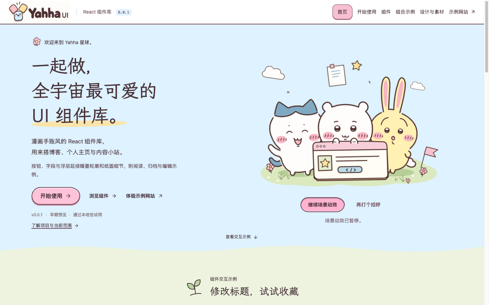
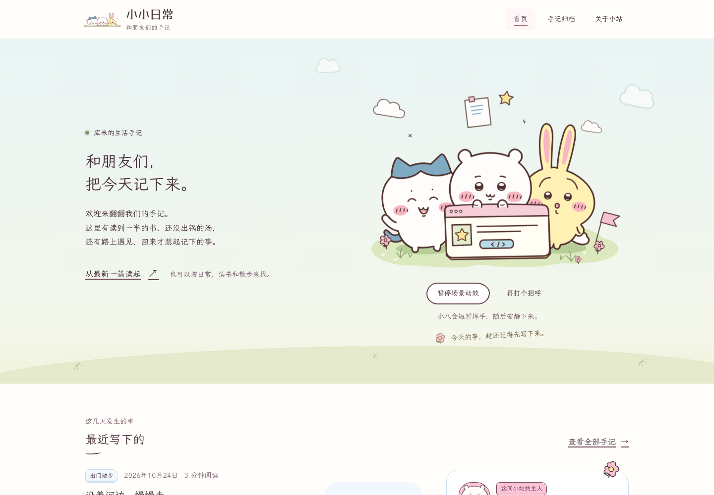

# Yahha UI

**一起做，全宇宙最可爱的 UI 组件库。**

Yahha UI 是一套漫画手账风 React 组件库，面向博客、个人主页与内容网站。

组件采用暖墨轮廓、白纸内容面、粉色强调与浅蓝纸边，提供交互示例、API 和可复制的网站组合。

[开始使用](#构建与本地安装) · [组件文档](https://github.com/didilili/yahha-ui/blob/main/docs/README.md) · [完整博客示例](https://github.com/didilili/yahha-ui/tree/main/examples/blog) · [设计语言](https://github.com/didilili/yahha-ui/blob/main/docs/design-language.md) · [问题反馈](https://github.com/didilili/yahha-ui/issues) · [变更记录](https://github.com/didilili/yahha-ui/blob/main/CHANGELOG.md)

**v0.0.1 · 早期预览** · React / React DOM `^19.3.1` · 29 个 UI 组件与 ThemeProvider · 当前通过本地安装包试用，尚未发布 npm



## 把可爱，搭进你的世界

站点以 **Yahha 星球** 组织首页与示例场景；基础组件可独立使用，不依赖角色图案。

- **为内容网站准备**：阅读、分类、搜索、收藏与轻量表单可以组合成完整小站。[博客示例](examples/blog/README.md)提供库米的首页、手记归档与文章详情。
- **每次操作，都好好回应**：组件继承使用方字体，常规控件为 44px，Button / IconButton 有 36 / 44 / 52px 三档；键盘、原生表单、焦点与减少动效按实际组件能力处理。
- **按需加入小场景**：静态 SVG、状态动效和可暂停的欢迎场景独立提供。基础组件不依赖角色图片，组件安装包不包含网站、字体或场景素材。

## 浏览组件

文档站的组件总览位于 `#/components`，按八类展示现有 29 个 UI 组件，并单列 ThemeProvider 主题配置，共 30 个文档入口。小样进入对应文档后，可操作完整示例、展开代码并查阅 API；当前共 97 个同源 TSX 示例。


- **通用**：Button、IconButton。
- **排版**：Text、Heading、Link。
- **布局**：Surface、Divider。
- **表单**：TextField、Textarea、Select、Checkbox、RadioGroup、Switch、SegmentedControl。
- **内容展示**：Badge、Avatar、Image、Accordion。
- **导航**：Tabs、Pagination。
- **浮层**：DropdownMenu、Dialog、Popover、Tooltip。
- **反馈**：Alert、Toast、EmptyState、Spinner、Skeleton。
- **主题配置**：ThemeProvider。

[查阅组件示例与 API](docs/README.md) · [查看设计规则和尺寸规范](docs/design-language.md)

## 导出最小项目

还没有 React 项目时，可以在本仓库安装依赖后，一次导出带有本地组件包的最小项目：

```sh
npm run create:starter
```

命令输出仓库外的项目目录与 `.zip` 路径；需要指定位置时，执行 `npm run create:starter -- --output /absolute/path/yahha-ui-starter`。不会覆盖非空目录或已有压缩包。生成 ZIP 需要系统 `zip`，脚本会先检查；接收和运行导出项目不需要它。工具版本从根 package.json 与 lockfile 读取，导出物保留实际 `.tgz`、版本和 SHA-256 清单。

解压后进入含有 package.json 的目录，运行 `npm install` 与 `npm run dev`，打开终端输出的地址即可试用标题输入与收藏按钮；`npm run build` 完成类型检查和静态构建。首次安装需要网络，标题与收藏只保留在当前页面。已有 React 项目继续按下一节安装组件包即可。

在导出项目中运行 `npm run docs`，无需安装依赖即可打开配套的完整文档、API、示例与博客预览。`documentation/` 是导出时生成的静态快照，包含官网使用的字体、角色与相应声明；最小应用的 `src/` 和组件 `.tgz` 仍不依赖这些资源。自己的页面构建在 `dist/`，部署时只上传它的内容，保留资源文件名，不上传 `vendor/` 或 `documentation/`。

需要现有博客的整套排版和源码时，使用：

```sh
npm run create:starter -- --example blog
```

生成的独立博客同样使用真实安装包，并附改站、部署和文档说明；原仓库中的 `examples/blog/` 继续共用根工具链。

## 构建与本地安装

当前通过本地 `.tgz` 安装。使用方需要已有的 React / React DOM `^19.3.1` 浏览器应用，以及支持 CSS 导入的构建工具。仓库开发基线为 Node.js ≥22.22.3、npm 10.9.8。

**1. 在组件库根目录生成安装包**（已有 `.tgz` 时直接进行第 2 步）：

```sh
npm ci
npm run build:lib
npm pack
```

**2. 切换到自己的 React 项目安装**，替换成刚生成文件的实际位置：

```sh
npm install /absolute/path/yahha-ui-0.0.1.tgz
```

**3. 保存下面的 `App.tsx`**，由现有应用入口渲染：

```tsx
import { useState } from 'react';
import { Button, ThemeProvider } from 'yahha-ui';
import 'yahha-ui/style.css';

export default function App() {
  const [saved, setSaved] = useState(false);

  return (
    <ThemeProvider theme="pink">
      <Button aria-pressed={saved} onClick={() => setSaved(!saved)}>
        收藏这篇文章
      </Button>
    </ThemeProvider>
  );
}
```

启动应用后，点击或用 Space 操作“收藏这篇文章”按钮，可切换收藏状态。操作名称保持稳定，选中状态通过按钮外观与 `aria-pressed` 表达。

样式只需在应用入口导入一次；`ThemeProvider` 的 `theme` 必填。推荐使用粉色预设（`pink`），另有浅蓝（`blue`）与浅黄（`yellow`）可选。三者是同一套组件的强调色变体，布局、字阶和交互保持一致。[预设名称与旧名兼容](docs/components/theme.md#theme-names)见主题文档。

其他示例按文档站的“完整接入”保存原样 `Example.tsx` 与独立 `App.tsx`；有素材清单时，单独下载并保留 `artwork/` 相对路径。完整素材示例按 Vite 8 / TypeScript 7 验证，`?raw`、`?no-inline` 导入需要相应构建工具支持。

安装包只分发组件、类型、样式与包说明。只有 `.tgz` 时可先使用本节的 `App.tsx`，再从顶部组件文档入口查完整 API；本地项目 ZIP 另附可通过 `npm run docs` 打开的完整文档快照。仓库图片和相对文件链接不表示相应资源进入 `.tgz`。

## 问题反馈

遇到安装、样式或交互问题，可[提交 GitHub Issue](https://github.com/didilili/yahha-ui/issues/new?template=bug_report.yml)。模板会收集组件版本、React 与构建工具、重现步骤及预期和实际结果。完整代码与类型声明见 [Yahha UI 仓库](https://github.com/didilili/yahha-ui)。GitHub 入口需要网络和仓库访问权限。

## 本地开发

在本仓库完成 `npm ci` 后，可以分别运行文档站和博客：

```sh
npm run dev
```

打开终端输出的文档站地址，从首页进入组件总览与指南。站内路由包括 `#/components`、`#/guides/getting-started` 和 `#/guides/artwork`。

```sh
npm run dev:blog
```

打开终端输出的博客地址，体验搜索、分类、分页、收藏与阅读返回。示例位于同仓库的 `examples/blog/`，共用根目录工具链；没有另一份 package.json 或 workspace。所有文章均为虚构示例，收藏保存在当前浏览器，不连接后台。



[博客运行与改站说明](examples/blog/README.md) · [手机阅读实拍](docs/images/yahha-mobile-reading.png) · [截图来源与更新方式](docs/images/README.md)

## 构建与静态部署

```sh
npm run build:demo
npm run build:blog
```

文档站输出至 `demo-dist/`，博客输出至 `examples/blog/dist/`；两者使用相对资源和 hash 路由。可以分别托管，也可以放在同一静态目录的根路径与 `blog/` 子目录。

[部署说明](docs/deployment.md)提供构建、保留字体声明、合并副本及本地预览的完整步骤。当前提供本地构建与预览流程，尚未提供线上预览地址。

## 当前能力与边界

- 组件以 ESM、类型声明和独立 CSS 入口分发；React / React DOM 是 peer dependencies，`@base-ui/react` 是运行时依赖。展示工具与素材不进入组件安装包。
- 当前验证范围是 React 19 浏览器应用。React 18、SSR 和其他构建工具兼容性尚未验证；素材示例的构建工具范围见上文。
- Select 当前为单值选择，不包含搜索与多选；Pagination 由调用方更新列表与路由；Tooltip 是视觉文字补充，触发器需要自身可访问名称。具体 API 和键盘约定以[组件文档](docs/README.md)为准。
- 版本为 `0.0.1`，`private: true`，尚未发布 npm。本文不提供未经验证的 npm 公开安装命令或线上文档地址。

## 素材与范围

项目自有内容采用 [MIT 许可证](LICENSE)，第三方内容见[第三方说明](THIRD_PARTY_NOTICES.md)。

[素材与分发范围](docs/assets-and-distribution.md)汇总实际目录、原始记录、派生关系与分发位置。[图标与插画](playground/src/examples/scenes/artwork/little-days/README.md)说明静态、动效及欢迎控制器的使用区别。

## 仓库目录

```text
src/             组件、公开类型与主题
playground/      文档站、交互示例及展示素材
examples/blog/   完整博客示例，共用根工具链
docs/            使用与维护说明、生成的组件 Markdown
scripts/         构建、资源同步、验收与项目导出
tests/           工程脚本、浏览器和真实安装包验收
```

组件文档在 `playground/src/docs/components/` 维护，`docs/components/` 由同份页面数据生成。博客保留独立运行所需的资源副本，由同步脚本核对；这些目录不进入组件安装包。

## 参与开发

源码目录、依赖边界、Git hooks 和验证方式见[协作说明](CONTRIBUTING.md)；[AGENTS.md](AGENTS.md)记录仓库协作约定。[设计语言](docs/design-language.md)保留设计依据。

小改动按影响范围选择检查；公共 API、构建或依赖边界变化使用完整 `npm run check`。
