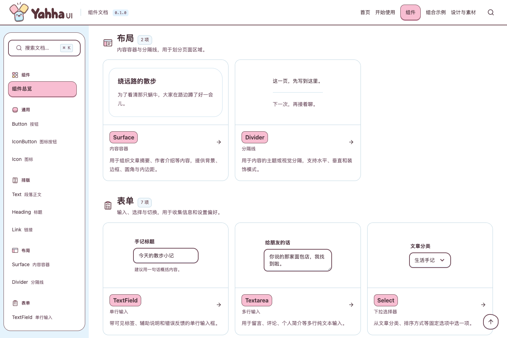

<a id="yahha-ui"></a>

<p align="center">
  <a href="https://yahhaui.com/">
    <picture>
      <source media="(prefers-color-scheme: dark)" srcset="https://raw.githubusercontent.com/didilili/yahha-ui/main/playground/src/assets/brand/yahha-ui-logo-on-dark.svg">
      
    </picture>
  </a>
</p>

<h1 align="center">Yahha UI</h1>

<p align="center"><strong>把可爱，搭进你的世界。</strong></p>

<p align="center">一套漫画手账风 React 组件库，面向博客、个人主页与内容网站。</p>

<p align="center">
  <a href="https://www.npmjs.com/package/yahha-ui"></a>
  <a href="https://github.com/didilili/yahha-ui/actions/workflows/ci.yml"></a>
  <a href="https://github.com/didilili/yahha-ui/blob/main/LICENSE"></a>
</p>

<p align="center">
  <a href="https://yahhaui.com/">访问官网</a> ·
  <a href="#安装与接入">开始使用</a> ·
  <a href="https://yahhaui.com/#/components">浏览组件</a> ·
  <a href="https://github.com/didilili/yahha-ui/blob/main/CHANGELOG.md">变更记录</a>
</p>

[](https://yahhaui.com/#/components)

<a id="把可爱搭进你的世界"></a>

## 从一个按钮开始

- **漫画手账风**：暖墨轮廓、柔和配色与纸感细节，提供 32 个 UI 组件与 ThemeProvider。
- **三套主题配色**：粉色、浅蓝与浅黄预设，支持通过公开属性和语义颜色定制；组件继承你的项目字体。
- **可复制的内容页面**：阅读与收藏、归档与搜索、文章编辑等组合，提供交互预览、源码与 API。示例使用演示数据，实际数据与保存逻辑由你的项目接入。

**Yahha 星球**是首页与示例故事的舞台，基础组件可以独立使用。组件包不包含文档站的角色图片、字体或场景素材。[看看首页场景](docs/images/yahha-home.png) · [了解设计语言](docs/design-language.md)

<a id="构建与本地安装"></a>

## 安装与接入

在已有 React 项目中安装：

```sh
npm install yahha-ui
```

在 `App.tsx` 中导入样式并设置主题，由现有应用入口渲染：

```tsx
import { useState } from 'react';
import { Button, ThemeProvider } from 'yahha-ui';
import 'yahha-ui/style.css';

export default function App() {
  const [saved, setSaved] = useState(false);

  return (
    <ThemeProvider theme="pink">
      <Button aria-pressed={saved} onClick={() => setSaved(!saved)}>
        收藏这篇文章
      </Button>
    </ThemeProvider>
  );
}
```

启动应用后，点击或按 Space 即可切换收藏状态。样式在应用入口导入一次；`ThemeProvider` 的 `theme` 必填，可选 `pink`、`blue`、`yellow`。[完整入门指南](https://yahhaui.com/#/guides/getting-started) · [主题配置](docs/components/theme.md)

<a id="当前能力与边界"></a>

### 环境与版本

- React / React DOM `^19.3.1`、Node.js ≥22.22.3，以及支持 CSS 导入的 React 构建工具。
- 组件以 ESM、类型声明和独立 CSS 入口分发，React / React DOM 由使用方提供。
- 当前验证范围为 React 19 浏览器应用；React 18、SSR 和其他构建工具兼容性尚未验证。含素材示例在 Vite 8 / TypeScript 7 下验证。
- 文档随仓库源码更新，使用前请核对安装版本与[变更记录](CHANGELOG.md)。如需尚未发布的改动，可[从源码构建与安装](CONTRIBUTING.md#从源码构建与安装)。

<a id="浏览组件"></a>

## 浏览组件与示例

从 [Button](docs/components/button.md)、[Input](docs/components/input.md)、[Surface](docs/components/surface.md) 开始，或打开[组件总览](https://yahhaui.com/#/components)，按通用、排版、布局、表单、内容展示、导航、浮层和反馈查找组件。

- [组件文档](docs/README.md)：用途、可运行示例、API、键盘操作与支持范围。
- [Form 表单](docs/components/form.md)：集中管理字段值、校验、错误、提交和重置。
- [原生表单接入](docs/guides/forms.md)：原生取值、校验与焦点、重置及七类控件的接入差异。
- [主题与定制](https://yahhaui.com/#/guides/styling)：配色、布局、插槽与公开样式入口。
- [组合示例](https://yahhaui.com/#/guides/recipes)：阅读、归档、编辑与状态反馈。展开示例的“完整接入”可复制代码；含素材时按清单保留相对路径。

### 导出最小项目

没有现成 React 项目时，先[获取源码并安装依赖](CONTRIBUTING.md#从源码构建与安装)，再在组件库目录中运行：

```sh
npm run create:starter
```

默认在组件库旁生成 `yahha-ui-starter/`，内含本地组件包。进入终端输出的目录后运行 `npm install`、`npm run dev`。离线文档、ZIP 与指定输出位置等选项见[导出说明](CONTRIBUTING.md#导出最小接入项目)。

### 让 AI 使用 Yahha UI

可以把下面的说明连同页面需求发送给 AI 编程工具：

```text
请用 Yahha UI 为我的 React 项目实现【页面需求】。
先确认项目安装的 yahha-ui 版本，再核对该版本支持的 API。
安装与接入：https://github.com/didilili/yahha-ui/blob/main/README.md
组件 API 与示例：https://github.com/didilili/yahha-ui/blob/main/docs/README.md
main 分支文档可能包含尚未发布的改动，不要直接用于旧版本。
在应用入口导入 yahha-ui/style.css，并使用 ThemeProvider theme="pink" 包裹组件区域。
使用库已有组件和公开 API 实现页面，布局、内容和业务状态放在我的项目中。
```

<a id="问题反馈"></a>
<a id="参与开发"></a>
<a id="本地开发"></a>
<a id="构建与静态部署"></a>
<a id="仓库目录"></a>

## 反馈与贡献

遇到安装、样式或交互问题，可[提交 GitHub Issue](https://github.com/didilili/yahha-ui/issues/new?template=bug_report.yml)，附上组件版本、React 与构建工具、重现步骤及预期和实际结果。也欢迎通过 Issue 提出组件需求或文档建议。

我们想一起做，全宇宙最可爱的 UI 组件库。参与开发请阅读[协作说明](CONTRIBUTING.md)，其中包含源码安装、运行文档站、目录结构与验证方式。

[本地开发](CONTRIBUTING.md#本地开发) · [构建与部署文档站](CONTRIBUTING.md#文档站构建与部署) · [版本与发布](docs/releasing.md)

<a id="素材与范围"></a>

## 许可证与素材

项目自有内容采用 [MIT 许可证](LICENSE)。部分展示素材为 Chiikawa 非官方同人创作，MIT 不包含第三方角色形象、名称或商标的权利，详见[第三方说明](THIRD_PARTY_NOTICES.md)。

[素材与分发范围](docs/assets-and-distribution.md)记录组件、字体与展示素材的来源和分发位置；[图标与插画](playground/src/examples/scenes/artwork/little-days/README.md)说明独立场景素材的使用方式。
